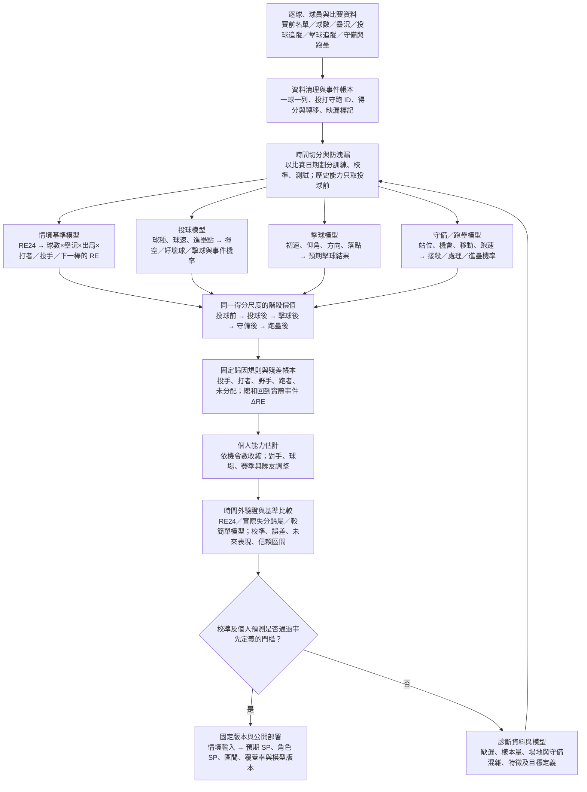

# CPBL SP：最終完整引擎流程圖

這是**目標架構**，不是宣稱目前所有模組皆已完成。網站目前的投手 SP 是事件分帳值，不能以此稱為已驗證的個人投球能力。

## 固定的得分與歸因定義

- 進攻方事件得分變化：`SP_event = runs_scored + RE_after - RE_before`。壘況、出局、球數、打者、投手、下一棒與未來續局共同決定情境 RE；RE24 是必須保留的基準。
- 投手投球品質（防守方）：`SP_pitch_quality = RE_before - RE_after_pitch`。投球後模型只能加入當球投球資料，不能偷看擊球初速或是否安打。
- 打者擊球貢獻：投球後至擊球後的預期得分變化；野手及跑者分別使用其決策前後的得分差。守備及跑壘若缺位置／速度追蹤，保留未分配項，不以「剩餘值」假稱已識別的個人能力。
- 各階段差值與最後殘差必須對帳回事件總 SP；方向與進攻／防守視角分別標記，不能將同一得分變化重複分配。
- 個人分數應以投球前已知的對手能力、場地及守備環境調整，並對低樣本球員收縮。將下一棒對得分價值的影響放在情境 RE，而非事後洩漏結果。

## 資料與驗證門檻

1. 先驗證完整逐球時間線：所有球（含非打席結束的球、球數變化）、跑者獨立事件與投手更換；位置資料缺失要留旗標。
2. 在保留整場比賽不跨切分的前提下做多個往後移動的時間切分，另外留真正未用於選模的測試期。
3. 機率模型比較 Brier、log loss 與校準；情境得分比較 MAE／RMSE／校準，與 RE24、球數版 RE、簡單打投能力模型對照。用比賽聚類 bootstrap 給出誤差差異區間。
4. 個人歸因以先前期間的投手 SP 預測後續期間的投手控制指標或對手校正得分；與先前期間的實際失分、K／BB 等基準比較。需同時報樣本數、收縮方式、排名穩定度及信賴區間。預測關聯不等於因果效果。
5. 任一必要門檻未過，只展示「情境 SP／事件分帳」，不得宣稱「已驗證個人投球貢獻」。

## 目前實際進度（2026-11-13）

- 已完成：2026 資料的一球一列事件引擎、球數情境基準、投球前與投球後機率模型、部分擊球／守備／跑壘模型，以及 2026-08-23 的時間外測試。
- 既有時間外測試：41,970 球訓練、18,287 球測試；投球後相對投球前的 MSE 差異以比賽 bootstrap 得到 95% 區間 [-0.00163, 0.00121]，未確認提升。
- 新增探索性個人檢驗：測試集 2026-08-23 至 2026-10-06 再分成兩期，31 位投手各期至少 60 球。前期投球品質 SP 對後期逐球防守得分變化的 Spearman 為 -0.080，前期實際逐球防守得分變化基準為 0.304；兩者差 -0.385，投手抽樣 bootstrap 95% 區間 [-0.868, 0.159]。**門檻未通過**。這是探索性檢查，同一測試期被再次分割，且後期實際得分仍受守備等因素影響；不是最終獨立驗證。
- 待完成：更多跨賽季資料、守備站位與跑壘追蹤或可信代理、正式預先定義之個人驗證，及網站以已驗證模型替換目前事件分帳值。
