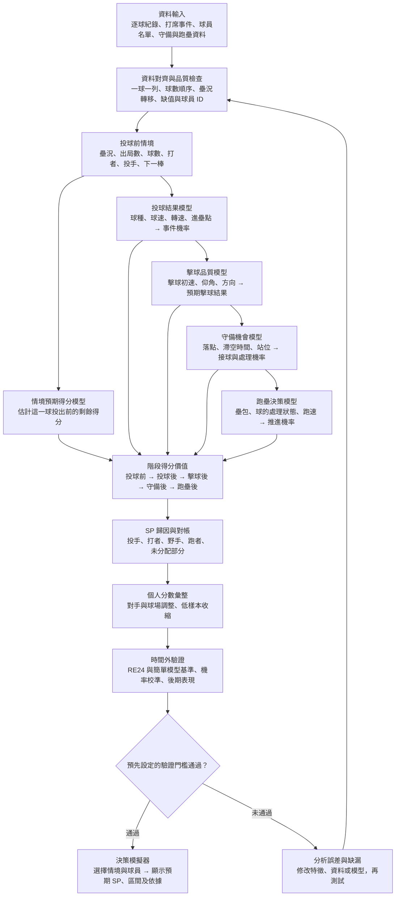

# CPBL SP｜逐球情境得分與球員貢獻模型

**評審展示版・最終模型架構**  
SP（Situational Performance）以「預期得分的變化」衡量每一球，並依投球、擊球、守備、跑壘的發生順序分配貢獻。情境包含壘況、出局數、球數、投打能力與下一棒。

## 完整模型流程圖



### 如何解讀 SP？

```text
事件總 SP（進攻方）＝當球得分＋球後預期得分－球前預期得分
投手投球品質 SP（防守方）＝球前預期得分－觀察投球資訊後的預期得分
```

球前預期得分不是固定的 RE24 數字：即使壘況相同，球數、打者、投手或下一棒不同，數值也可以不同。擊球、守備、跑壘各以其發生**前後**的預期得分差計算。各角色分數連同「資料不足、無法歸因」的餘額，須對帳至同一事件總 SP；不會把所有未解釋的失分直接記給投手。

### 模型與驗證設計

| 層次 | 輸入與預測 | 主要檢查 |
|---|---|---|
| 情境得分 | 投球前壘況、球數、打投與下一棒 → 剩餘得分 | 與 RE24、球數版 RE 比較誤差與校準 |
| 投球與擊球 | 進壘資訊 → 結果機率；接觸後資訊 → 預期擊球結果 | Brier score、log loss、時間外測試 |
| 守備與跑壘 | 相近機會下的出局／推進機率 | 覆蓋率、校準、分情境誤差 |
| 個人貢獻 | 逐球 SP 累積，校正環境並收縮低樣本 | 前期分數能否預測後期表現；與實際失分等基準比較 |
| 決策輸出 | 更換打者、投手或下一棒後重新計算 | 標明樣本與不確定性；不能將觀察關聯直接當成換人因果效果 |

**防止資料洩漏：**訓練、校準與測試依日期及整場比賽切分；球員能力只使用當球之前的比賽。投球模型不得提前讀取擊球初速與最後的安打結果。所有結果附樣本數與不確定性區間。

### 本次展示的實際範圍

目前已有逐球事件整理、球數與情境預期得分、投球前後模型，以及部分擊球／守備／跑壘模組與公開試算介面。既有 2026-08-23 時間切分包含 **41,970 顆訓練球、18,287 顆測試球**；加入投球資訊後的得分預測改善尚未獲統計確認。初步個人投手驗證亦未勝過簡單基準。

因此，本圖呈現的是**完整產品架構與驗證路徑**；目前網頁上的投手 SP 為事件分帳值，並非已驗證的投手個人能力。守備站位、跑壘追蹤與正式跨期間個人驗證，屬後續建置項目。
