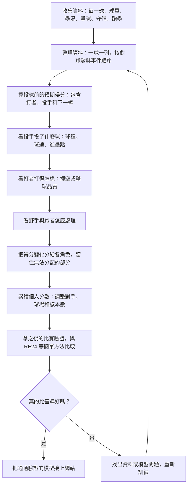

# CPBL SP：完整模型要怎麼做？

> 這張圖說的是我們**最後想做出的完整引擎**。目前網站只完成其中一部分；哪些功能還沒通過驗證，下面會直接說清楚。

## 先用一球理解它

假設二壘有人、兩人出局，投手投了一顆偏甜的球，打者打出強勁滾地球，游擊手沒接到，跑者回本壘。

我們想分別回答：

1. **這個情境本來有多容易得分？** 二壘有人、兩出局、現在打者和下一棒是誰，都會影響答案。
2. **投手投的球讓對方更容易得分嗎？** 看球速、球種、進壘位置等；這一步還不能偷看打者打出去的結果。
3. **打者打得比這顆球通常會被打得更好嗎？** 看擊球初速、仰角、方向等。
4. **游擊手處理得如何？** 跟其他人在相近落點、球速和站位下的處理機率比較。
5. **跑者跑得如何？** 跟相似跑壘機會的平均結果比較。

每一步都比較「**這一步發生前**」和「**發生後**」的預期得分。所有分數加上暫時分不清的部分，必須等於這球最後造成的總得分變化。若沒有野手站位或跑者速度，應留作「尚未分配」，不能硬算成投手或野手的能力。

## 最終完整流程



## 資料實際怎麼整理？

先把比賽紀錄接到逐球紀錄，做成**一球一列**。同一打席如果投了五球，就應有五列；「最後是一壘安打」只貼在第五球，不能當作第一球就已經知道。

然後從 0 好 0 壞開始，逐球核對壞球、好球、界外球與最後的保送、三振或擊球結果。如果球序斷掉，或最後一球和官方打席結果對不上，先記下原因，暫時不要用這個打席計分。

球員能力也有時間限制：算 8 月 10 日的球，只能用 8 月 9 日以前的比賽估計打者、投手和下一棒的能力。進壘點可以用來評投球，但**擊球初速、仰角和最後有沒有安打**，都不能提前放進投球前的模型。

每個模型各自回報能用多少資料。例如沒有擊球仰角的一球，仍可能可用於投球模型，但不能拿來訓練擊球品質模型。缺資料的原因和比例要跟結果一起公布。

## SP 是怎麼算的？

先算這球對**進攻方**造成多少得分變化：

```text
這球的總 SP = 這球立刻得到的分數 + 這球之後的預期得分 − 投球前的預期得分
```

例如，投球前預期得分是 0.6；結果跑回 1 分，而且球後還預期能得 0.3 分，那這球的進攻方總 SP 就是 **+0.7 分**。防守方看同一事件則是 −0.7 分。

要算投手投球品質，則比較**投球前**與**看到這球的投球資料後**的預期得分。如果投球讓進攻方的預期得分降低 0.05，投手在這一步得到 +0.05 分。打者、野手和跑者用各自那一步的前後差值計算。RE24 只用壘況與出局數，會保留作最基本的比較對象。

## 怎樣才能說「個人 SP 經過驗證」？

不能只看「每球的結果機率猜得準不準」，也不能只把今年投手排個名。必須用**過去的資料算分數，拿之後沒有參與訓練的比賽檢查**：

- 整場比賽按日期切開；同一場的球不能一半訓練、一半測試。
- 預期得分與結果機率要和 RE24、簡單打投模型比較，檢查誤差與預測是否偏高或偏低。
- 前期投手 SP 要和前期實際失分等簡單指標競爭，看誰比較能預測**後期**表現；樣本少的投手不能只憑幾球排到第一。
- 野手和跑者也必須用各自的後期資料驗證。若沒有足夠的站位、跑速或實際處理機會資料，就不能宣稱已精確算出個人能力。

## 現在做到哪裡？

現有引擎已把 2026 的合格紀錄整理成一球一列，能算球數情境、投球前與加入進壘資訊後的預期結果，也做了部分擊球、守備與跑壘處理。它以 **2026-08-23** 切分訓練與測試：前段 **41,970 球**、後段 **18,287 球**。

但「加入投球資料」的預期得分表現，與投球前模型相比，差異仍不足以確認真的改善。我們又把後段分成兩期做一個**初步**個人檢查：有 31 位投手各期至少投 60 球；前期投球品質 SP 預測後期逐球防守得分變化的排名相關是 **−0.080**，而用前期實際得分變化做基準是 **0.304**。這次沒有勝過基準，而且後期得分仍受守備等因素影響。

**因此目前網站上的「投手 SP」是事件分帳值，還不能說是經過驗證的個人投球能力。**完整模型要繼續補齊資料、改善預測，並通過上面的後期驗證後，才用新版分數取代它。
