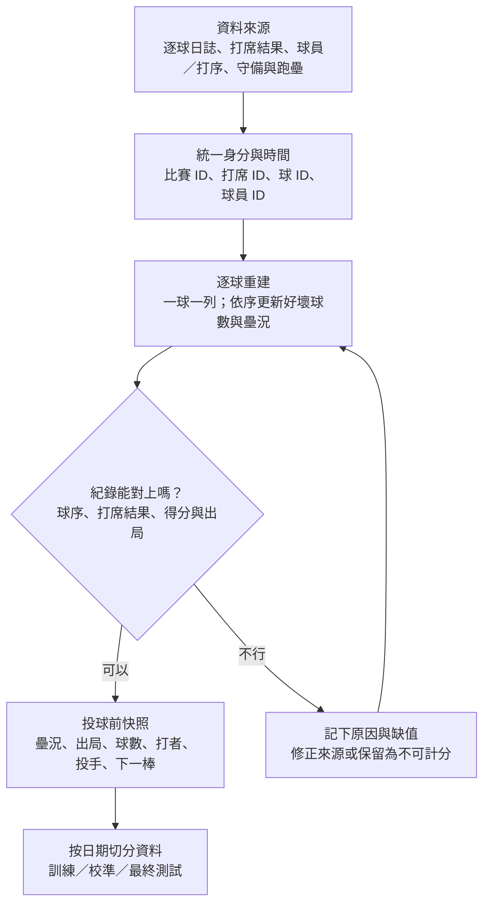
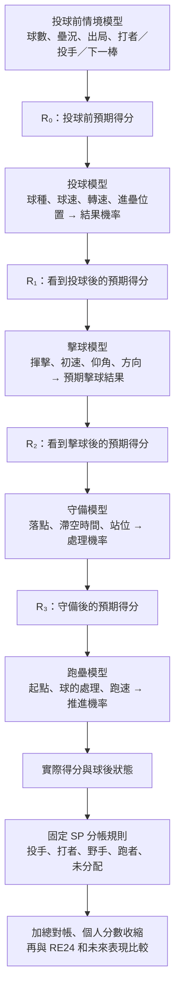
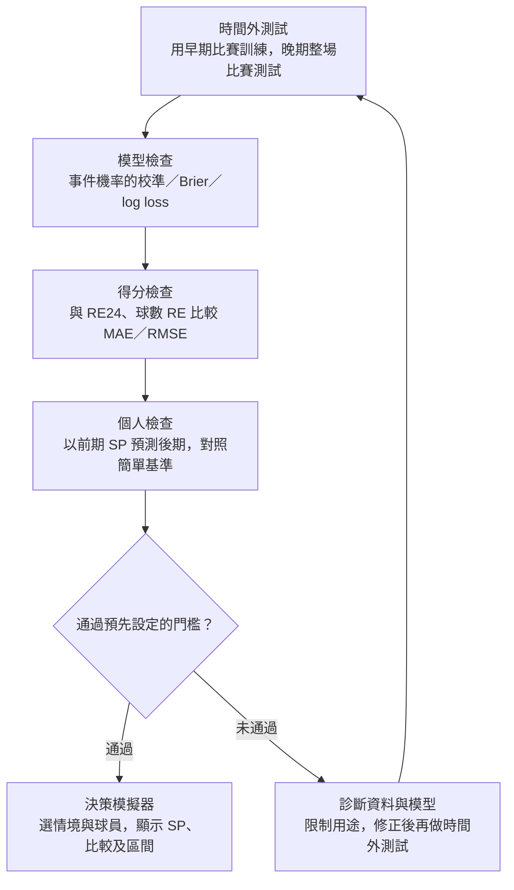

# CPBL SP｜評審用完整模型流程

**提案目標：**把每一球對得分機會的影響，用同一把「預期得分」尺量出來，再按投球、擊球、守備與跑壘的發生順序分配貢獻。以下為規劃中的完整架構。

## A. 原始紀錄如何變成可用資料

**處理原則：**歷史球員能力只計算到該球發生前；同一場比賽不能同時放進訓練和測試。缺少擊球追蹤的球仍可能用於投球模型，但不能假裝有擊球初速；缺野手站位時不得宣稱已精確識別接球機會。

## B. 同一球如何從投球前算到最後

**SP 的方向：**進攻方的事件總 SP ＝ 當球得分＋球後預期得分－投球前預期得分。投手投球品質的防守方 SP ＝ R₀－R₁；打者、野手和跑者分別看自己那一步造成的預期得分差，並統一正負號。最後所有角色分數加上無法分配的餘額，必須與事件總 SP 對帳，不能讓同一分得分重複算給多人。

**例子：**二壘有人、兩出局，投球前預期得分 0.6；若這球得 1 分，之後還有 0.3 的預期得分，進攻方事件 SP 為 **+0.7**。接著才看球的位置、擊球品質、野手機會和跑者選擇，分出這 0.7 如何形成。下一棒能力影響投球前及後續情境價值，不能在事後偷看真正打席結果。

## C. 驗證後才能用於決策

**簡報用一句話：**「我們先把每球還原為可信的時間線，再用模型估計每一步改變多少得分機會；分帳後必須對得上總分，而且得通過晚期比賽的驗證，才能當作個人決策指標。」

**提案界線：**圖是預計完成的完整方法；互動網頁是現階段原型，不能以其角色數字直接宣稱已驗證個人能力或換人後的因果收益。
